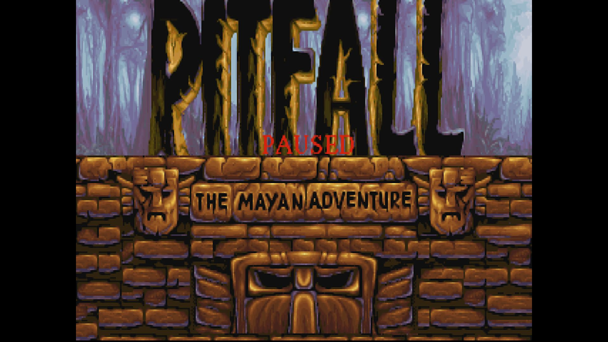
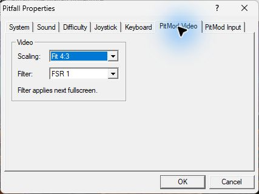
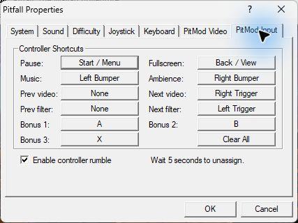
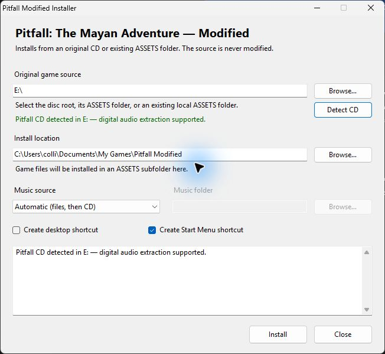

# Pitfall: The Modified Adventure

**Pitfall: The Modified Adventure** is an unofficial modification and modern
Windows compatibility layer for the Windows 95 release of **Pitfall: The Mayan
Adventure**. It keeps the original game and data while replacing or extending
the Windows-era display, audio, configuration, installation, and controller
paths that no longer behave correctly on current systems.

The repository and release installer do **not** contain the original game
executable, game data, music, or other Activision assets. You must supply your
own compatible retail copy.

The installer verifies the supported retail `PITFALL.EXE` and copies it
**byte-for-byte unchanged**. Compatibility behavior is supplied by independent
DLLs loaded alongside the game; no patched game executable is generated or
distributed.

## Screenshots

### Accelerated fullscreen presentation



### Video and scaling options



### XInput shortcuts and rumble



### CD and portable installer



## Highlights

### Smooth, accelerated fullscreen video

- Replaces the obsolete 16-bit `DISPDIB.DLL` display path with a modern
  Direct3D 9 presentation layer.
- Fixes the severe frame-pacing hitches seen in the original Windows mode by
  presenting the game’s native framebuffer at a stable 60 Hz.
- Provides borderless and exclusive-style fullscreen without the taskbar or
  legacy window borders.
- Keeps the original 320×200 artwork intact while allowing modern display
  presentation.

### Scaling and video filters

- Aspect-correct integer scaling modes for narrow, native, and wide displays.
- Raw, fit-to-4:3, and stretch-to-display modes.
- None, scanline, CRT-mask, edge-aware XBR-style, and FSR 1-style filters.
- Live controller shortcuts can cycle scaling and filter modes in fullscreen.

### Modern controller support and rumble

- XInput controller support with hot-plug detection.
- Configurable game actions, bonus-game buttons, pause, fullscreen, music,
  ambience, scaling, and filter shortcuts.
- Custom rumble responses for damage, attacks, movement, pickups, hazards,
  enemies, environmental mechanisms, and other identified sound events.
- Rumble can be enabled or disabled with a UI toggle, while individual effect
  strengths can be customized in `PITMOD.INI`.

### Restored audio

- DirectSound replacement for the original WAIL sound-effects library.
- Working sound-effect and music volume controls.
- Music and ambient audio from portable WAV files or an original game CD.
- Correct pause/resume, looping, track switching, and level transitions.

### CD and portable installation

- Installs from an original retail CD or an existing retail `ASSETS` folder.
- Can play audio from the physical CD or extract its audio tracks to portable
  local WAV files.
- Can import data and audio from a BIN/CUE image without modifying the image.
- Supports a user-selected installation directory rather than requiring a
  hidden application-data folder.
- Stores game and mod preferences in a portable local INI file instead of the
  Windows registry.
- Registers a normal Windows uninstall entry while preserving the original
  source disc or folder.
- Leaves the installed retail `PITFALL.EXE` byte-identical to the supported
  original executable.

### Original CD behavior

- The game’s original CD validation logic continues to run unchanged.
- Physical-CD playback uses the drive’s real table of contents.
- Extracted CD audio, BIN/CUE imports, and user-supplied supported music files
  expose a virtual mixed-mode CD interface using track information derived
  from the supplied media rather than a built-in retail track table.
- The project does not provide game files or music and does not attempt to
  determine how users created their own local media files.

## Additional features

- Original properties dialog extended with dedicated **PitMod Video** and
  **PitMod Input** tabs.
- Original game preferences, keyboard mappings, difficulty, unlocked levels,
  audio state, and mod options persist locally.
- Fullscreen can be toggled through the original display menu, **F11**, or a
  configurable controller shortcut.

## Repository layout

- `src/pitmod.c` — display, timing, virtual CD, configuration, UI, and XInput
  compatibility layer.
- `src/winmm_proxy.c` / `src/winmm_proxy.def` — early loader and forwarding
  proxy for the real Windows multimedia library.
- `third_party/pitfall-win11-wail/` — attributed MIT-licensed WAIL replacement.
- `installer/` — source for the CD/local-files installer.
- `config/PITMOD.INI` — documented configuration template.
- `tools/` — local DLL build script.

## Building

The DLL build currently expects an i686 LLVM-MinGW toolchain. Run:

```powershell
.\tools\build.ps1
```

To build the installer, first copy locally built `PITMOD.DLL`, `WAIL32.DLL`,
`WINMM.dll`, `PITMOD.INI`, and `THIRD_PARTY_NOTICES.txt` into
`installer\payload`, then run:

```powershell
.\installer\build-installer.ps1
```

Generated executables and DLLs are intentionally ignored by Git.

## Installing manually

Start with an `ASSETS` directory copied from a supported retail installation.
Keep its original `PITFALL.EXE` unchanged. Back up the retail `WAIL32.DLL`,
then place the locally built `PITMOD.DLL`, replacement `WAIL32.DLL`,
`WINMM.dll`, and `PITMOD.INI` beside the executable. Put supported audio files
in the configured music folder or select physical-CD playback in `PITMOD.INI`.

The release installer is the recommended installation method because it
verifies the retail executable, offers physical CD and BIN/CUE import options,
creates shortcuts, and registers the uninstaller.

## Third-party component

The replacement WAIL implementation is derived from Alessandro Ramos’s
MIT-licensed project. Its original copyright and license are retained in
`third_party/pitfall-win11-wail/LICENSE`. Binary installer distributions embed,
install, and separately provide the same terms in
[`THIRD_PARTY_NOTICES.txt`](THIRD_PARTY_NOTICES.txt).

## Credits

- **`mistermorcus`** — project direction, extensive gameplay
  testing, compatibility research, effect identification, tuning, and release
  validation.
- **OpenAI Codex** — collaborative engineering assistance across reverse
  engineering, compatibility-layer implementation, debugging, build tooling,
  installer development, documentation, and release preparation.
- **Alessandro Ramos** — original MIT-licensed replacement WAIL implementation
  on which this project’s sound-effects library is based.

See [CREDITS.md](CREDITS.md) for additional detail.

Pitfall: The Mayan Adventure, its name, and its original files are owned by
their respective rights holders. This is an unofficial fan-made compatibility
project and is not affiliated with or endorsed by Activision.

## License

The original code and documentation in this repository are available under
the [MIT License](LICENSE). The included third-party WAIL component remains
governed by its separately retained MIT license and copyright notice under
`third_party/pitfall-win11-wail/`.

The project license does **not** grant rights to *Pitfall: The Mayan
Adventure*, the Pitfall or Activision names and trademarks, or any original
game executable, data, artwork, audio, music, or other assets. Those materials
are not included in this repository or its release installer and remain the
property of their respective rights holders.

